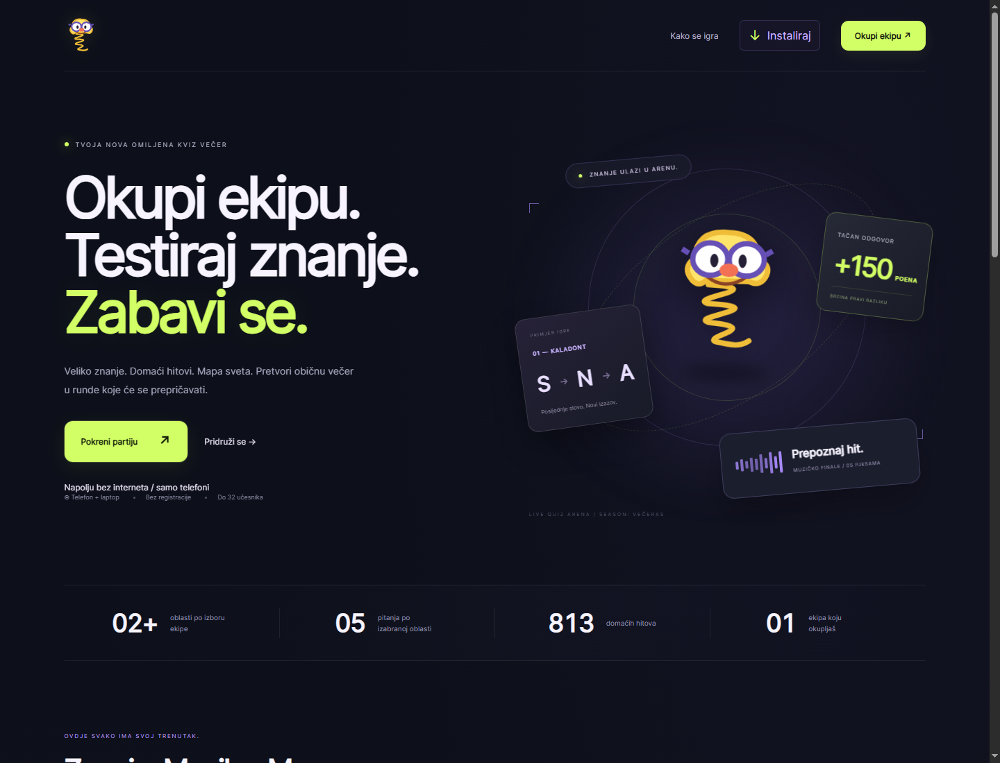
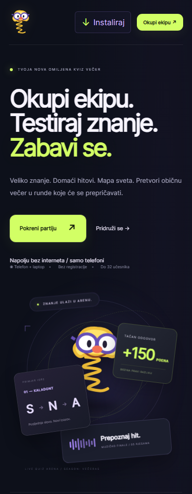
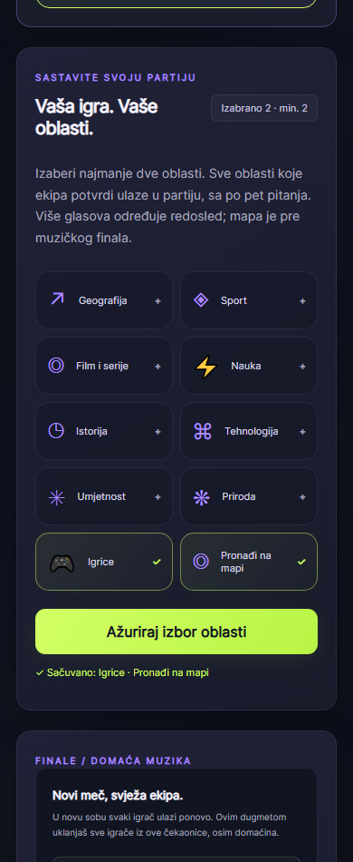
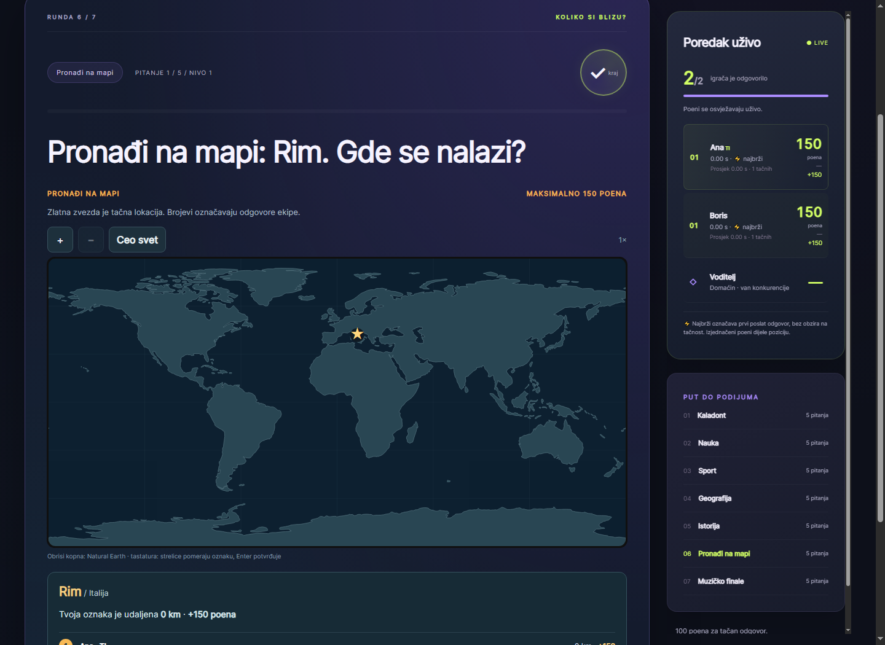

# Live Quiz Arena

**Okupi ekipu. Testiraj znanje. Zabavi se.**

Multiplayer kviz za računar i telefon: napravi sobu, podeli PIN ili QR kod i takmičite se uživo. Kaladont opšteg znanja, oblasti koje ekipa bira, mapa sveta i domaći hitovi u muzičkom finalu — bez registracije.



## Šta aplikacija trenutno nudi

| Funkcija | Trenutno ponašanje |
| --- | --- |
| Igra uživo | Do 32 učesnika u sobi, ulazak nadimkom i PIN-om ili pozivnicom |
| Izbor oblasti | Svaki takmičar potvrđuje najmanje dve oblasti; sve potvrđene oblasti ulaze u partiju |
| Baza znanja | 2.250 tekstualnih pitanja, devet oblasti, pet nivoa težine i izbor koji podstiče raznovrsnost |
| Mapa sveta | 50 lokacija, pomeranje i uvećavanje mape, bodovi prema udaljenosti |
| Muzičko finale | Pet pitanja iz kataloga od 813 domaćih hitova, uz prepoznavanje naslova ili izvođača |
| Voditelj | Može voditi partiju van konkurencije ili uključiti „Igram sa ekipom“ |
| Rezultati uživo | Serverski tajmer, zaključavanje odgovora, bodovanje i konačan poredak |
| Instalacija | Desktop prečica i instalabilna web aplikacija za telefon preko HTTPS-a |
| Direktna offline igra | Do osam telefona, prethodno sačuvani paket i direktno povezivanje preko QR kodova |

Oblasti: **Geografija, Sport, Film i serije, Nauka, Istorija, Tehnologija, Umjetnost, Priroda i Igrice**. **Pronađi na mapi** je dodatna kartica u istom izboru i računa se u minimum od dve oblasti.

## Pogled u aplikaciju

Snimci su napravljeni u stvarnoj aplikaciji. Izbor oblasti i mapa koriste izolovanu probnu partiju sa testnim učesnicima.

| Početni ekran na telefonu | Izbor oblasti |
| :---: | :---: |
|  |  |



## Kako se igra

1. Voditelj pravi partiju i deli PIN, link ili QR kod iz čekaonice.
2. Igrači ulaze sa svojim nadimkom i potvrđuju najmanje dve oblasti. Voditelj uključuje „Igram sa ekipom“ ako želi da se takmiči.
3. Partija počinje sa pet Kaladont pitanja. Svaka izabrana oblast zatim dobija pet pitanja; više glasova određuje redosled oblasti.
4. Ako je mapa izabrana, igra se pre muzičkog finala. Svaki igrač postavlja i potvrđuje svoju oznaku; cilj i tuđi odgovori otkrivaju se po isteku vremena.
5. Pet muzičkih pitanja zatvara partiju, a zatim se prikazuje konačan poredak i proglašenje pobednika.

Partija ima **20–60 pitanja**, zavisno od izabranih oblasti. Vreme za obična pitanja je 10, 15 ili 20 sekundi; mapa traje 30 sekundi, a muzika dobija dodatnih pet sekundi. Za obična pitanja važe tačnost i bonus za brzinu, a za mapu udaljenost od cilja.

## Pokretanje na Windows računaru

Potrebni su **.NET 8 SDK**, **Node.js 20+ sa npm-om** i **SQL Server**. Desktop pokretač koristi lokalni servis `MSSQL$SQLEXPRESS`. U `BE/appsettings.json` podesi `ConnectionStrings:DefaultConnection` prema svojoj SQL instanci. Muzička tabela `MusicTracks` kreira se i puni automatski.

```powershell
git clone https://github.com/markom2002/live-quiz-arena.git
cd live-quiz-arena
npm.cmd --prefix FE ci
.\install-desktop-app.ps1
```

Zatim otvori desktop aplikaciju **Live Quiz Arena**. Ona proverava SQL Express, pravi noviji build po potrebi, pokreće server i priprema internet pozivnicu. Ručno pokretanje istog prozora:

```powershell
.\open-arena.ps1 -AppWindow
```

Desktop se otvara na `http://localhost:5087/`. **Telefon koristi link ili QR iz čekaonice**, jer `localhost` na telefonu označava sam telefon. Zatvaranje prozora aplikacije ne zaustavlja server. Logovi pokretača su u `.qa/launcher-*.log`.

## Tri načina igranja

| Režim | Šta je potrebno |
| --- | --- |
| Internet Arena | Računar sa serverom i SQL bazom ostaje uključen; igrači otvaraju aktuelnu HTTPS pozivnicu sa bilo koje mreže |
| Lokalna Wi-Fi Arena | Računar i telefoni su na istoj mreži; koristi se LAN pozivnica, a računar vodi partiju |
| Direktno telefon–telefon | Učesnici unapred pripreme aplikaciju; domaćin sačuva pitanja i muziku, pa povezuje goste preko ponudnog i povratnog QR koda na istom hotspotu/Wi-Fi mreži |

Za pokretanje samo lokalne Arene:

```powershell
.\open-arena.ps1 -AppWindow -LocalOnly
```

Za direktnu igru izaberi **Napolju bez interneta / samo telefoni**. Tokom pripreme na internetu koristi **Sačuvaj pitanja i muziku**. Za samu direktnu partiju laptop, SQL i internet nisu potrebni. Domaćin mora ostati u aplikaciji, a mreža mora dozvoljavati povezivanje uređaja. Ranije sačuvan paket treba osvežiti da sadrži nove oblasti i mapu.

## Veza, instalacija i ograničenja

- Internet pozivnica koristi privremeni Cloudflare tunel. Adresa može da se promeni i nije stalni javni hosting; staru pozivnicu zameni novom iz čekaonice.
- Server proverava da javna adresa zaista vodi do iste instance aplikacije. Zdrava veza se ponovo koristi pri pokretanju.
- Instalacija na telefonu i offline web mogućnosti zahtevaju HTTPS. Na iPhone-u koristi Safari → Podijeli → Dodaj na početni ekran. Obična LAN HTTP adresa služi za igranje kroz browser.
- Internet/LAN partija zahteva dostupan server. Direktni offline režim je poseban tok koji se prethodno priprema i ne prenosi automatski voditelja ako se njegov telefon isključi.
- Novi muzički isečci zavise od dostupnosti izvora; lokalno pripremljeni snimci koriste se u odgovarajućem offline režimu.
- Trenutni frontend build prolazi uz postojeća upozorenja o React hook zavisnostima. Browser provere nisu zamena za fizičku probu svake kombinacije telefona i hotspota.

Detaljnije u [uputstvu za aplikaciju i povezivanje](docs/APP.md).

## Razvoj

Frontend koristi **React 19 + TypeScript**, backend **ASP.NET Core / .NET 8**, a muzika se čuva u **SQL Server** katalogu. Direktna igra telefona koristi **WebRTC**, **IndexedDB** i ručnu razmenu QR kodova. Mapa koristi lokalne vektorske obrise; spoljne map tiles usluge nisu potrebne.

```powershell
# Terminal 1, iz BE/
dotnet run --launch-profile http

# Terminal 2, iz FE/
npm ci
npm start
```

Razvojni frontend je na portu 3000 i koristi proxy ka serveru na 5087. Production aplikacija koristi isti origin za interfejs i Arena API.

## Provere

```powershell
dotnet build BE/BE.csproj
dotnet run --project tests/ArenaChecks
dotnet run --project tests/MapChecks
dotnet run --project tests/ConnectionChecks
python scripts/check-question-bank.py
npm.cmd --prefix FE test -- --watchAll=false --runInBand
npm.cmd --prefix FE run build
```

Frontend trenutno ima **52 testa u 16 test paketa**. Serverske provere pokrivaju bodovanje, dozvole, tajmere, izbor oblasti, cele partije, mapu i proveru internet pozivnice.

Za stvarni ulazak kroz mobilni browser, uz pokrenut desktop server i lokalno instaliran Edge:

```powershell
# Postavi trenutnu LAN ili HTTPS adresu iz svoje aplikacije:
$env:ARENA_TEST_URL = 'http://IP-RACUNARA:5087'
node tests/phone-join-browser.mjs
```

Za probnu partiju i ponovno snimanje prikaza:

```powershell
# Terminal 1:
dotnet run --project tests/MapChecks -- --serve

# Terminal 2:
$env:ARENA_TEST_URL = 'http://127.0.0.1:5198'
node tests/arena-browser.mjs
node tests/category-selection-browser.mjs
node tests/map-round-browser.mjs
```

Browser testovi čuvaju slike u `.qa/`. Odabrani snimci za ovaj README nalaze se u `docs/screenshots/`.

## Struktura projekta

```text
FE/src/                  Početni ekran, Arena, offline igra i frontend testovi
FE/public/               Manifest, ikone i statički resursi
BE/Arena/                Pravila igre, server, muzika i podaci pitanja
BE/Migrations/           Istorija postojeće SQL šeme
scripts/                 Provere baze i priprema resursa
tests/                  Serverske i browser provere
docs/screenshots/        Aktuelni snimci aplikacije
```

Stare stranice naloga, administracije i ranijeg kviza, njihovi API-ji i nepotrebne biblioteke su uklonjeni. SQL modeli i migracije čuvaju istoriju postojeće baze; postojeći podaci se ne brišu i nisu izloženi kroz stare API-je. Lokalno stanje i tokeni u `BE/arena-data/`, buildovi, preuzeti alati i `.qa/` nisu deo Gita.

Izvori i uredničke napomene: [pitanja](docs/QUESTION_SOURCES.md) · [obrisi mape](FE/src/components/map/README.md).
